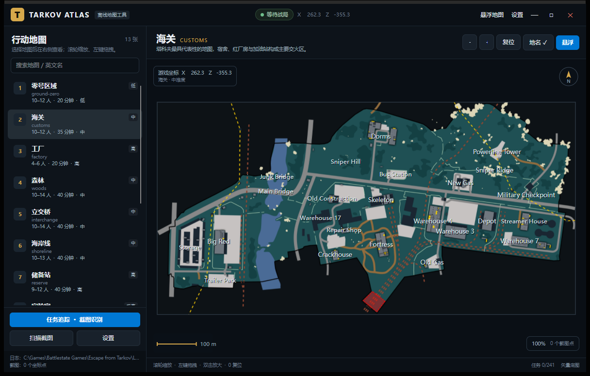

# Tarkov Atlas · 逃离塔科夫地图与任务助手

用 **C# + Avalonia** 编写的 Windows 桌面地图工具，以 **.NET NativeAOT** 发布，生成的 `TarkovAtlas.exe` 不依赖目标电脑安装 .NET 运行时。



## 功能

### 地图

- **13 张当前战局地图**，采用游戏内官方中文名：中心区、海关、工厂、森林、立交桥、海岸线、储备站、实验室、灯塔、塔科夫街区、迷宫、码头、破冰船。
- **朝向与官方一致**：底图按 tarkov.dev 官方呈现方向输出（游戏坐标 x 向右递减、z 向下递增），不存在南北颠倒。
- **离线高清底图**：矢量 SVG 与社区瓦片在构建阶段烘焙成本地 JPG（最长边 5600 px），不请求在线瓦片。
- **浏览**：左侧列表 + 搜索；滚轮缩放、左键拖拽、双击放大、`0`/`Home` 复位、比例尺与指北针。
- **中文地名**：地标名已本地化（红厂房、宿舍、伐木场、疗养院……），商店品牌名保留原文。
- **按层显示**：地图上方下拉框可手动切层；开启「按高度自动切层」后，截图坐标的 y 值落到哪一层就自动切到哪一层。
  楼层图在构建阶段已 warp 到与底图完全相同的像素栅格，运行时只套同一个目标矩形，不会错位。
  目前有楼层图的 6 张地图共 33 层：海关 4、工厂 3、储备站 5、中心区 3、实验室 2、破冰船 16。
- **危险区**：雷区（红）/ 狙击区（橙）/ 其它危险区（紫）以半透明多边形叠加，可在「显示」菜单整体开关。

### 显示内容（工具栏「显示」菜单）

| 项目 | 说明 |
| --- | --- |
| 撤离点 | 开关；并可筛选 **全部 / 仅 PMC·共享 / 仅 Scav·共享 / 仅共享** |
| Boss 刷点 | 各 Boss 的刷新位置与概率 |
| 出生点 | PMC / Scav 出生位置（默认关闭，避免拥挤） |
| 转移点 | 地图间转移点（默认关闭） |
| 任务地点标记 | 已勾选「追踪」的任务目标点 |
| 危险区 | 雷区 / 狙击区 / 其它危险多边形（默认开启） |
| 地名 | 地标文字 |

设置会立即保存。

### 悬浮地图

- **无边框正方形小窗**，默认停靠屏幕**右侧中间**，**中心始终跟随你最新的截图坐标**。
- 可拖右下角缩放、`Ctrl+Alt+M` 显示/隐藏、`Ctrl+Alt+L` 锁定鼠标穿透。
- 透明度与缩放比例可在设置中调整。
- 可用鼠标右键拖拽边缘缩放，尺寸/位置即时保存。

### 任务

- **离线任务库 503 条**（tarkov.dev JSON API，2026-10 快照），任务名已官方中文化。
- 选中某张地图时，右侧**只列出该地图可做的任务**；一旦在搜索框输入，就自动放开为**全库搜索**。
- 勾选「追踪」后，该任务的目标点会以**派发任务的商人头像**为图标画在地图上。
- 每个有坐标的任务带「跳转到地图 ▸」按钮：
  - 单地图任务直接切图并对准目标；
  - **多地图任务（非击杀类）会弹出地图选择菜单**，选择后再跳转。
- 「标记完成 / 取消」、全部 / 未完成 / 已完成筛选。
- 任务识别：**任务页面截图 OCR**（Windows 自带离线 OCR + 模糊匹配），识别不全时直接在列表搜索勾选。
- **Wiki 用大傻哥**：任务详情里的「打开 Wiki」指向 https://www.eftarkov.com/task/{id} ，
  「任务地点图」在应用内的图片查看器中直接显示标注图 https://www.eftarkov.com/uploads/task/{id}.webp （支持滚轮缩放、拖拽平移），不需要另开浏览器。

### 截图定位

- 监听 `Documents\Escape from Tarkov\Screenshots`，从文件名解析 `x, y, z` 与四元数朝向。
- 在地图上画出带编号的定位点与朝向箭头，点击可看文件名、时间、坐标。
- **读完即删**：坐标写入后删除截图文件（设置中可关闭），不在截图目录留垃圾。

### 权限

- 可执行文件嵌入 `requireAdministrator`，启动即请求管理员权限 —— 这样在游戏占据前台时，全局快捷键依然能触发。

## 系统要求

- Windows 10 1809 / Windows 11，x64。
- 运行发布版**不需要** .NET；只需系统 VC++ 运行库（Windows 10/11 自带）。
- 启动会弹 UAC 提权提示（为了全局热键）。
- OCR 需要 Windows OCR 语言包；英文系统默认可用。

## 直接运行

```
TarkovAtlas.exe
av_libglesv2.dll
libHarfBuzzSharp.dll
libSkiaSharp.dll
Assets/
  Maps/         13 张地图 JPG + mapdata.json
  traders/      13 个商人头像（任务标记用）
  quests.json   离线任务库
Scripts/ocr.ps1 Windows OCR 桥接
README.md  LICENSE  THIRD-PARTY-NOTICES.md
```

解压后双击 `TarkovAtlas.exe`。设置与进度写入 `%APPDATA%\TarkovAtlas\`。

## 从源码构建（NativeAOT）

需要 .NET 10 SDK + Visual Studio 生成工具（“使用 C++ 的桌面开发”）。

```powershell
.\build.ps1
```

或手动：

```powershell
dotnet publish .\TarkovAtlas\TarkovAtlas.csproj -c Release -r win-x64 --self-contained true
```

产物在 `TarkovAtlas\bin\Release\net10.0-windows\win-x64\publish\`；`build.ps1` 会收拢到 `dist\TarkovAtlas-win-x64\` 并打包 zip。

### 重新生成地图与任务数据

```powershell
# 1) 下载/烘焙底图（需要网络：tarkov.dev 与 GitHub）
python tools\build_assets.py
# 2) 合并官方中文名、撤离点、Boss、任务坐标
python tools\build_data.py
```

数据脚本读取 `research/` 下缓存的 tarkov.dev JSON API 快照，可离线重跑第 2 步。

### 校验

```powershell
dotnet run --project tools\datacheck   # 几何/投影/标记/本地化
dotnet run --project tools\logiccheck  # 任务筛选/追踪/头像规则
```

两个套件都必须输出 `ALL CHECKS PASSED`。

## 数据来源与许可

详见 [THIRD-PARTY-NOTICES.md](THIRD-PARTY-NOTICES.md)。

- 矢量地图：`the-hideout/tarkov-dev-svg-maps`（**CC BY-NC-SA 4.0**）。
- 地图几何、瓦片、中文名、撤离点、Boss、任务：`the-hideout/tarkov-dev` 与其 JSON API（MIT 代码）。
- UI：Avalonia、SkiaSharp、HarfBuzzSharp。

> 与 Battlestate Games 无关；Escape from Tarkov 及相关素材归其权利人所有。**请勿商用，也请勿用于作弊、雷达或破坏公平性的用途。**

## 已知限制

- 任务库是离线快照，新版本任务需要重新跑数据脚本或手动补充。
- 底图为主楼层静态图，不随截图 `y` 值切换楼层（坐标会显示高度）。
- 迷宫、破冰船等使用瓦片层，只含主层。
- 截图文件名不含地图 ID；边界重叠时依赖日志或当前选中地图判断。
- OCR 识别率受截图分辨率与语言包影响。
- 无地图坐标的任务（纯击杀/交付类）会显示在每张地图的列表里，但排在所有本图任务之后。
- README 中的界面截图来自旧版本，尚未按本次 UI 变更重新截取。

## 项目结构

```
TarkovAtlas/
  Program.cs / App.axaml     启动、主题、PerMonitorV2 DPI
  app.manifest               管理员权限 + DPI 感知
  MainWindow.axaml(.cs)      地图列表、显示菜单、任务抽屉
  OverlayWindow.axaml(.cs)   正方形跟随式悬浮窗
  SettingsWindow.axaml(.cs)  设置
  QuestScanWindow.cs         OCR 候选
  MapPickWindow.cs           多地图任务选择
  Controls/MapCanvas.cs      绘制：底图/楼层/危险区/撤离点/Boss/出生点/任务/定位
  Models/                    地图、任务、设置、截图
  ImageViewerWindow.cs       应用内图片查看器（任务地点图）
  Services/                  战局日志监听、截图、OCR、热键、持久化、任务过滤
  Assets/Maps/               底图 + mapdata.json + layers/ + hazards.json
  Assets/traders/            商人头像
  Assets/quests.json         本地化任务库
tools/
  build_assets.py            抓瓦片/渲染 SVG，输出官方朝向底图
  build_data.py              合并中文名与标记数据
  datacheck/ logiccheck/     自动化校验
```